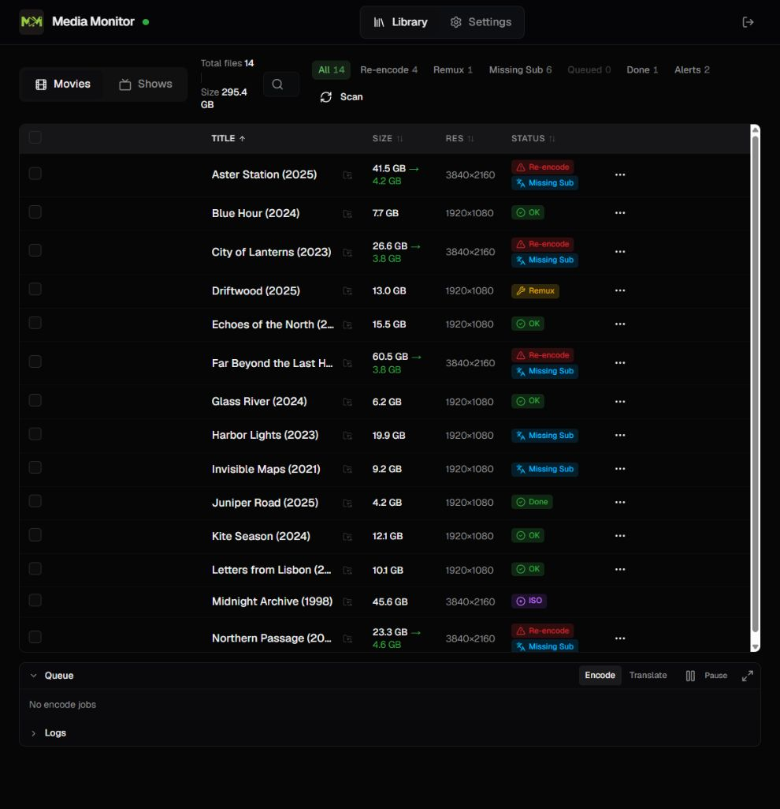
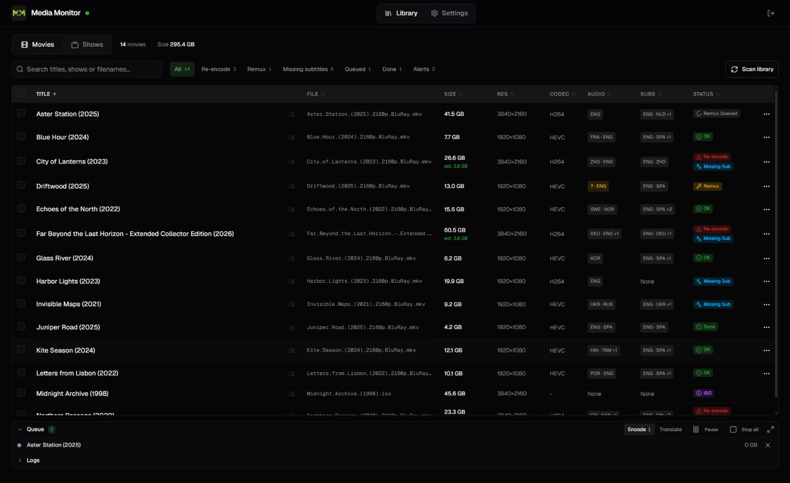
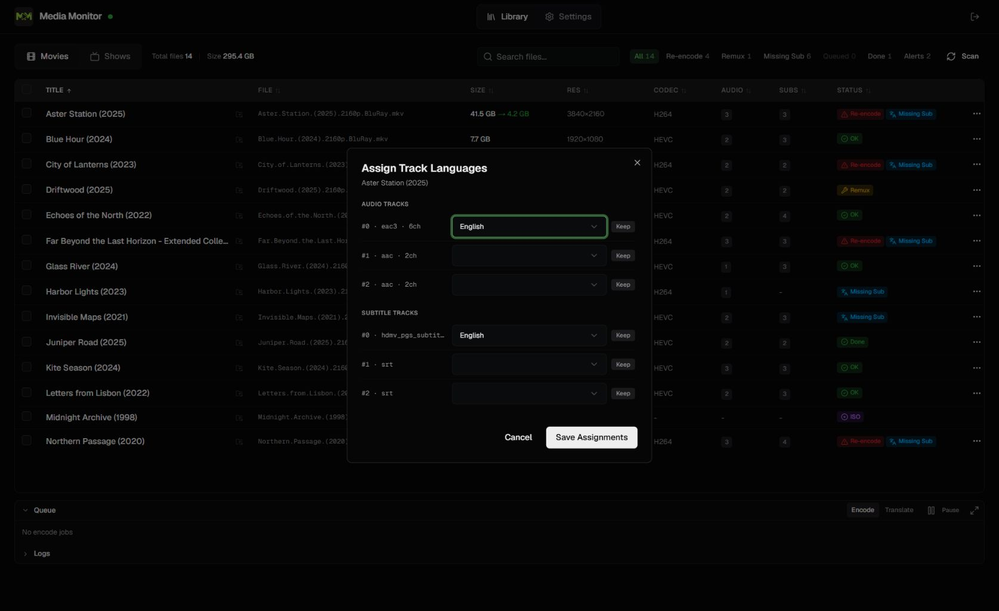
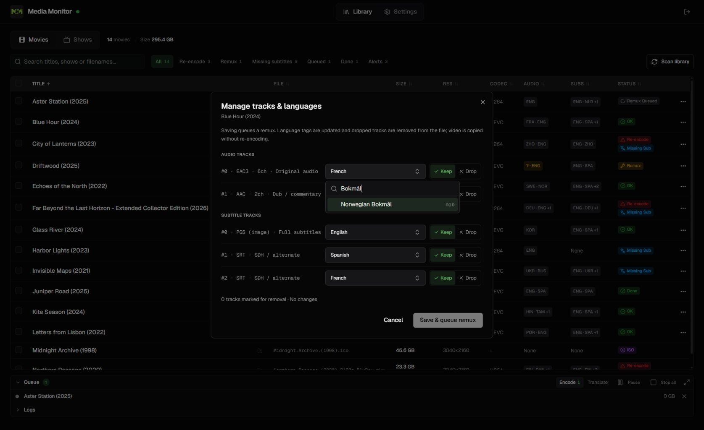
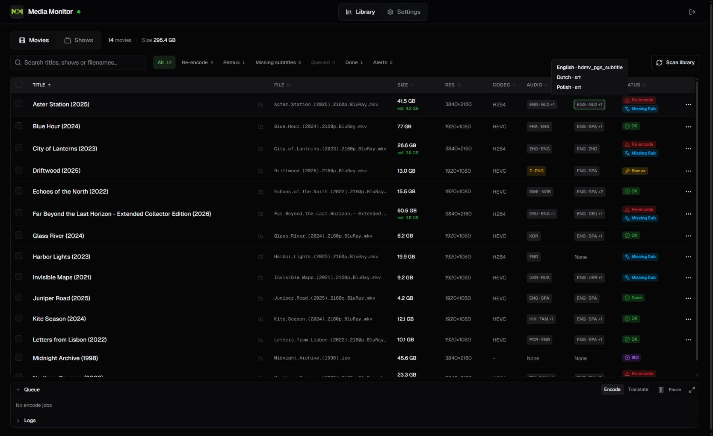
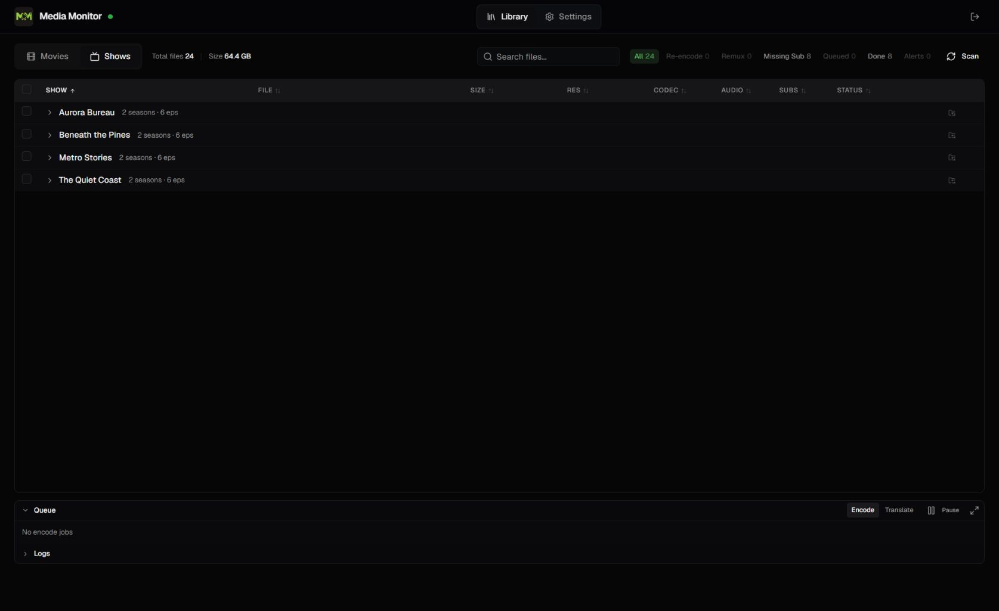
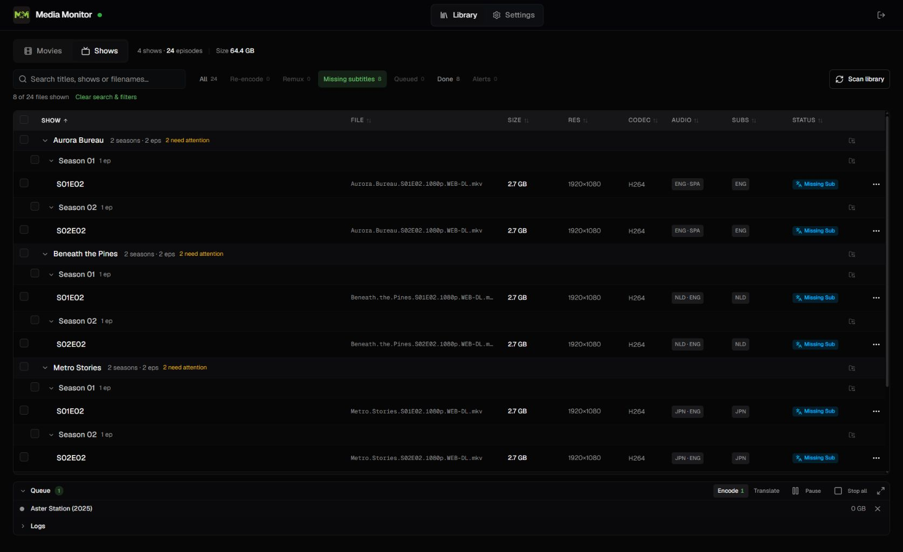
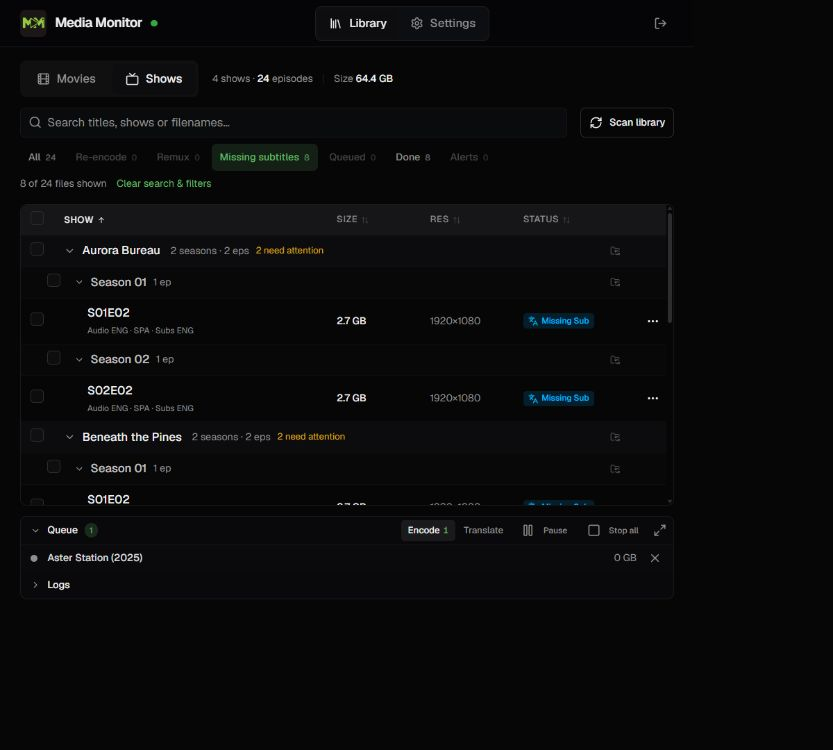
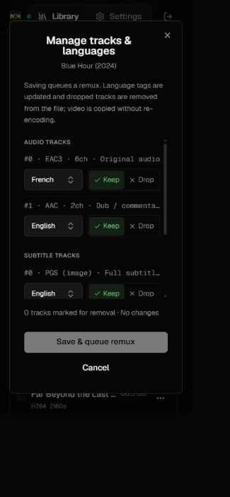

# Library UX review

Reviewed on November 3, 2026, using the local preview with 14 fictional movies and 24 episodes across four shows. The goal was to make it easier to identify files needing attention, inspect languages, and choose which tracks to retain.

## Captured flow and health

1. **Browse Movies — improved.** The original medium-width toolbar compressed search into an icon-sized field, while hidden table columns reserved space and truncated titles. Search now has room, filters have a separate wrapping row when needed, column widths follow visible headers, and language summaries replace anonymous counts.

   
   

2. **Manage tracks — fixed.** The original editor displayed blank values for Dutch and Polish because they were absent from its short dropdown. The picker now searches 486 ISO 639-2 entries by name, code, or alias; existing unlisted codes remain visible. `dut` and `nld`, for example, resolve to Dutch. Accented names such as Norwegian Bokmål were checked in the rendered picker.

   
   

   Keep and Drop are explicit choices. The editor shows track titles (including commentary/SDH), a removal count, and unsaved state. It requires at least one audio track, disables language editing on dropped tracks, and names the action **Save & queue remux**. The explanation states that dropped tracks will be removed from the file. A backend correction also lets **Unknown / unassigned** clear an existing language tag, including copied metadata in the remux command.

3. **Inspect track/status help — improved.** Library filenames, track details, status badges, rescan buttons, queue controls, and header controls use the app's dark tooltip styling. Track/status details are also reachable by keyboard focus. Language badges show readable summaries, with full names and codecs in the tooltip.

   

4. **Find show episodes needing work — improved.** The original collapsed hierarchy gave no indication of issues within a show. Show rows now summarize how many episodes need attention; search/filter matches expand their shows and seasons automatically. The show/season expanders and sort headers are keyboard-operable buttons. Visible selections are cleared when they fall out of the current view, and switching Movies/Shows starts with all files.

   
   

5. **Use narrower windows — improved.** Grouped rows previously created phantom table columns because their spans included hidden columns. Their spans now track the responsive layout. On mobile, queue/bulk actions wrap, tracks have direct entry points, and the track editor scrolls its list while keeping Save and Cancel visible. A narrow-screen DOM check confirmed the page fits the viewport.

   
   

6. **Save track edits — verified through the queue.** Editing a fictional movie saved the selected languages/actions, closed the dialog, selected the Queued filter, and created a remux job. Queue execution was deliberately not started in the demo.

## Recommended next improvements

- **Highest priority: a file-details drawer opened from the title.** Keep the table compact, then put the full filename, duration, track titles, language names, status reasons, and recommended next action together in a drawer. This would also reduce the long per-track translation/download menus.
- **Explain the exact missing language per file.** “Missing Spanish subtitles” is more useful than “Missing Sub”. The backend should return the missing-language set, including sidecar subtitles, so the explanation stays accurate.
- **Make encoding language-retention rules configurable and visible before queuing.** Manual remux choices and the encoder's approved-language rules currently serve different operations. Show an output-track preview so users can see which tracks an encode will retain; avoid implying that a remux Keep choice overrides the encoder policy.
- **Add a compact queue summary when idle.** Keep active work visible, while letting the library use more height when nothing is running. Provide clear failure reasons and a retry action beside failed jobs.
- **Consider column preferences once the drawer exists.** Filename, resolution, codec, and language columns could be shown or hidden to match the user's screen and workflow.

## Evidence and validation limits

The review used current browser captures, interactive keyboard checks, medium/narrow viewport checks, and the real Flask APIs against the isolated demo database. Build, explicit TypeScript validation, 69 backend tests, and 10 frontend tests passed. New regression coverage includes aliases, unlisted codes, UTF-8 names, clearing language tags, dropped tracks, and output metadata indexes.

This is not a complete screen-reader or contrast audit. No actual video was encoded, remuxed, OCR'd, or translated in the preview. Fictional files do not exist on disk and the demo runner starts no media workers. Authentication and real media operation behavior were not changed by the demo runner.

Language names/codes are bundled from the [Library of Congress ISO 639-2 list](https://www.loc.gov/standards/iso639-2/php/code_list.php). Private/local-use or otherwise unlisted existing codes are preserved rather than silently replaced.
